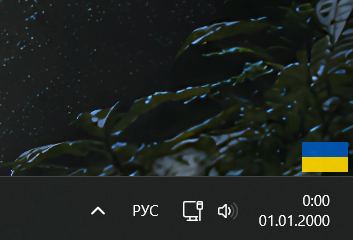

# Украинские буквы на любой клавиатуре

Нажали одну клавишу (по умолчанию правый Alt), и все буквенные клавиши печатают украинские буквы: `і ї є ґ` и все остальные. Нажали ещё раз, и клавиатура снова обычная. Пока режим включён, в углу экрана виден маленький флаг Украины.



Подходит тем, кто сидит на русской, английской, польской или любой другой раскладке и хочет печатать по-украински без переключения раскладок Windows и без запоминания, где какая украинская буква.

> Скрипт написан на 100% с помощью ИИ (вайбкодинг). Работает у автора, гарантий нет.

## Как это работает

Скрипт смотрит на физические клавиши, а не на символы, нарисованные на них. Поэтому текущая раскладка Windows не важна: в режиме украинских букв каждая клавиша выдаёт украинскую букву, которая стоит на ней в привычной ЙЦУКЕН-раскладке. Заодно это значит, что работает на любой клавиатуре и с любым языком ввода.

Если во время украинского режима вы переключите раскладку Windows, режим сам выключится, чтобы не мешать. Это можно отключить в настройках.

## Установка

**Вариант 1. Готовый `.exe` (проще всего).**
Скачайте `ukrainian-toggle.exe` со страницы [Releases](../../releases) и запустите. Ничего устанавливать не нужно.

**Вариант 2. Скрипт.**
Установите [AutoHotkey v2](https://www.autohotkey.com), скачайте `ukrainian-toggle.ahk` и запустите двойным кликом.

Дальше нажмите правый Alt. В углу появится флаг, и буквы начнут печататься украинскими.

### Автозапуск

Нажмите Win+R, введите `shell:startup` и положите в открывшуюся папку `.exe`, `.ahk` или ярлык на него. Если кладёте ярлык, оригинал должен остаться на месте.

## Настройки

Настройки лежат в начале файла `.ahk`, в блоке `Настройки`. Меняйте только значения справа от `:=`. После правки сохраните файл и перезагрузите скрипт: правый клик по значку «H» в трее, затем **Reload Script**.

Для `.exe` настройки менять нельзя: измените значения в `.ahk` и соберите `.exe` заново (см. ниже).

| Параметр | По умолчанию | Что делает |
|---|---|---|
| `TOGGLE_KEY` | `"RAlt"` | Клавиша-переключатель. Подойдут `"RCtrl"`, `"ScrollLock"`, `"Pause"`, `"F12"` и другие, см. [список клавиш](https://www.autohotkey.com/docs/v2/KeyList.htm). |
| `FLAG_WIDTH` | `46` | Ширина флага в пикселях. |
| `FLAG_HEIGHT` | `30` | Высота флага в пикселях. Классические пропорции 3:2, то есть высота примерно две трети ширины. |
| `MARGIN_RIGHT` | `6` | Отступ от правого края экрана. |
| `MARGIN_BOTTOM` | `4` | Отступ от панели задач. `0` прижимает флаг вплотную. |
| `MONITOR_NUMBER` | `1` | Номер монитора, на котором показывается флаг. |
| `COLOR_BLUE` | `"0057B7"` | Цвет верхней половины, формат RRGGBB без решётки. |
| `COLOR_YELLOW` | `"FFD700"` | Цвет нижней половины. |
| `SPLIT_OFFSET` | `0` | Сдвиг границы цветов в пикселях. `1` делает синюю часть выше, `-1` ниже. |
| `OPACITY` | `235` | Прозрачность от 0 (невидим) до 255 (непрозрачный). |
| `AUTO_DPI_SCALE` | `false` | `true` умножает размеры на масштаб Windows (125%, 150% и так далее). |
| `STANDARD_UA_LAYOUT` | `false` | `false`: на S буква `и`, на B буква `і` (по звуку, как русские `ы` и `и`). `true`: как в стандартной украинской раскладке, на S буква `і`, на B буква `и`. Остальные буквы одинаковы в обоих вариантах. |
| `AUTO_OFF_ON_LAYOUT_CHANGE` | `true` | `true`: при смене раскладки Windows в активном окне украинский режим выключается сам. `false`: режим работает, пока вы не выключите его вручную. |

## Изменение раскладки

Блок `Раскладка` состоит из строк вида:

```
"SC01F", ["и","И"]
```

Слева код физической клавиши, справа строчная и заглавная буквы.

- **Заменить букву:** поменяйте символы в квадратных скобках.
- **Убрать клавишу из режима:** удалите её запись. Между записями должны оставаться запятые, а после последней записи запятой быть не должно.
- **Добавить клавишу:** допишите запись по тому же образцу. Коды клавиш смотрите в [таблице AutoHotkey](https://www.autohotkey.com/docs/v2/KeyList.htm#SpecialKeys).

| Ряд | Коды по порядку |
|---|---|
| Верхний (Q W E R T Y U I O P [ ]) | `SC010` ... `SC01B` |
| Средний (A S D F G H J K L ; ') | `SC01E` ... `SC028` |
| Нижний (Z X C V B N M , .) | `SC02C` ... `SC034` |
| Обратный слэш `\` | `SC02B` |
| Тильда `` ` `` (на ней апостроф `ʼ`) | `SC029` |

## Сборка `.exe`

1. Установите [AutoHotkey v2](https://www.autohotkey.com), вместе с ним ставится компилятор Ahk2Exe.
2. Правый клик по `ukrainian-toggle.ahk`, затем **Compile Script**. Рядом появится `.exe`.
3. Если пункта в меню нет, запустите Ahk2Exe из меню «Пуск», выберите `.ahk`, а в поле Base File выберите файл версии v2 (64-bit) и нажмите Convert.

Антивирусы иногда ругаются на любые `.exe`, собранные AutoHotkey, это ложные срабатывания. Если сомневаетесь, запускайте исходный `.ahk`: код открыт и занимает около сотни строк.

## Ограничения

- Правый Alt занят переключателем и как обычный Alt не работает. Если он вам нужен, смените `TOGGLE_KEY`.
- Скрипт не работает в программах, запущенных от имени администратора. Решается запуском самого скрипта от администратора.
- В режиме перехватываются только буквенные клавиши. Цифры, пробел, Enter и сочетания с Ctrl работают как обычно.
- Если после правки ничего не изменилось, проверьте, нет ли в трее второй запущенной копии. Закройте все значки «H» (правый клик, затем Exit) и запустите заново.

## Лицензия

MIT.
